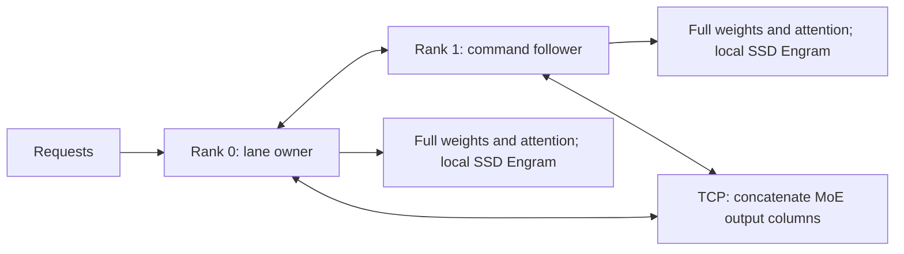

# DeepSeek-V4.1-Flash-1017: two M3 Ultra Macs, TCP and SSD Engram

This experimental path produces the same measured logits and tokens as the
single-rank EXL3 engine. It is slower over TCP: 2.78 decode steps/s for two Macs,
against 4.06 for one. It replicates the weights and attention on each Mac, so it
also does not reduce the memory needed per Mac. These are development receipts,
not release qualification.

A later [shared-family and whole-slot comparison](../ds1017-tp2-slots-2026-10-20/README.md)
records runtime `cdfa5203`. This folder retains the earlier `b27e39af` results.

## Scope and provenance

The measured runtime is `b27e39af70a101e4a964035e79335d1f0aa446de`, based on
upstream `d46d17a784758b8a8b66badde1f728f36bdc9541`. Both Macs have an M3 Ultra,
80 GPU cores and 256 GB unified memory. The Engram tables are on each Mac's
internal SSD. The weight sets are resident during the qualified decode runs;
their initial load location is outside the execution measurement.

[build.json](build.json) pins Zig 0.17.0, `-Dcpu=apple_m3` and binary SHA256s.
[model.json](model.json) pins the checkpoint and original 1017 Engram revision;
[pack-sha256.json](pack-sha256.json) records the measured checkpoint files, including the locally generated token map.
Do not substitute older V4.1 Engram tables: their shapes can load without
establishing that they are the correct model.

The source series includes the unmerged Metal family from #824 through #827,
then streamed Engram, decode changes and the experimental pair. Maintainer
choices about the shared CUDA/Metal family and whole-model gate remain open
on #847. This branch does not resolve those choices.

## Partition



Each rank calculates half the output columns of gate, up and down projections.
Each dot product keeps its full input reduction. The ranks gather the output
halves as bytes, with three exchanges per layer and one history handshake:
121 exchanges per forward across 40 layers. This preserves the measured
single-rank rounding order, but the synchronization costs exceed the saved
work in this experiment. This result does not measure MCDMA or RDMA.

## Model measurements

| Check | Single rank | Two ranks |
| --- | ---: | ---: |
| 32-token prompt, 128 generated tokens, decode forwards | 127 | 127 |
| Decode wall time | 31.2933 s | 45.6813 s |
| Decode forwards/s | 4.0584 | 2.7801 |
| Decode GPU time, measured rank | 30.6020 s | 33.8378 s |
| Execution reads | 126,844,928 bytes | 126,844,928 bytes per rank |
| Counted Engram reads | 126,844,928 bytes | 126,844,928 bytes per rank |
| Page-ins | 0 | 0 |

The runner's generation timing covers 127 decode forwards: prefill produces
the first of the 128 completion tokens. The single-rank sample ran on rank 1;
the two-rank timing above is rank 0. This is one runner sample per configuration,
not a three-run median. HTTP repetitions are reported separately.

[numerical.json](numerical.json) records zero logit bit disagreements on the
268-token teacher sequence at chunks 1, 2, 3, 7, 31, 127, 128, 129, 255 and 256.
Both ranks' logits match the prior single-rank artifact's SHA256. The 128
completion token IDs also match. Two lane slots at context 8192, chunk 16, finish
at positions 134/134 with zero bit disagreements against solo execution.
These comparisons establish partition parity for those inputs, not absolute
quality against the original checkpoint or FP64 on arbitrary inputs.

[measurements.json](measurements.json) retains the execution receipts, including
failed I/O gates. The teacher seam sweep reads about 0.5 MB beyond the counted
Engram rows on the single-rank run and on rank 0 of the pair; those gates fail.
Decode and paired lane gates pass on both ranks, with no page-ins. Do not treat
a correct logit comparison as a passed residency gate.

Each Mac passed 29 EXL3 GPU tests, 99 DeepSeek GPU tests and 28 reference tests.
The chosen template matched all five 1017 encoding fixtures. The token-map
builder's full Rust-normalizer parity, including Hangul, remains unqualified;
see [the normalization caveat](../../engram-token-map.md).

## Reproduce the runner comparisons

Build the runtime and qualification binaries with full Xcode and its Metal
Toolchain installed:

```sh
zig build native tf-dsv41-run check-deepseek-v41 check-exl3-gpu \
  test-deepseek-v41-tp-host -Dcpu=apple_m3
```

Set `TF_DSV41_SPLIT_RESIDENCY=1` and `TF_DSV41_RESIDENCY_REFRESH=1` on both Macs.
The measured model used 19 immutable weight residency sets, requested every
400 ms. Execution buffers use a separate set. These options are opt-in; they
address long pre-GPU residency stalls observed with the monolithic set.

The prompt ID arrays are in [prompts](prompts/). Run the one-rank engine first,
then use identical inputs, binaries and model manifests for both ranks. Set
`DSV41_ENGRAM_STREAM=1`; for the pair set `TF_DSV41_TP_SETTINGS` to each rank's
settings file. For example, with `MODEL`, `TABLES` and `RECEIPT` pointing to your local paths:

```sh
export DSV41_ENGRAM_STREAM=1
export TF_DSV41_SPLIT_RESIDENCY=1
export TF_DSV41_RESIDENCY_REFRESH=1
./zig-out/bin/tf-dsv41-run seams "$MODEL" "$TABLES" "$RECEIPT/prompts/mid.json" out/seams
./zig-out/bin/tf-dsv41-run generate "$MODEL" "$TABLES" "$RECEIPT/prompts/short.json" out/generate 128
./zig-out/bin/tf-dsv41-run lanes "$MODEL" "$TABLES" "$RECEIPT/prompts/mid.json" out/lanes 16 8192
```

For each paired command, start both ranks with their respective
`TF_DSV41_TP_SETTINGS` value. Use distinct output directories for single-rank
and paired runs. Preserve `logits.f32`, token IDs and `residency.json`, including
failed gates. The native server uses
`--engram-stream --speed-up <rank-settings.json>` instead of the runner variables.
See [the launch settings](../../deepseek-v41.md#experimental-two-mac-moe).

## Native HTTP state and failure checks

[http.json](http.json) records three sequential repetitions of three prompts,
three complete SSE samples, and comparison against the single-rank replies on
both Macs. It includes reasoning fields and finish reasons; it is a parity
check, not a task-accuracy score. The same checks repeat after restarting both
ranks.

Each paired phase also sends twelve requests from two clients, observes two
running slots through server metrics, and compares every reply with solo
execution. Closing a stream after its first generated delta must increment the
server's disconnect counter, drain the slots and leave the next reply equal to
solo. Stopping rank 1 makes two subsequent leader requests return HTTP 500 with
`restart both ranks`, in 0.127 and 0.114 seconds. Both processes then restart
before the repeated parity phase. Both paired phases pass, with zero observer
errors; the cancellation counters increment and queues drain in 0.528 and
0.471 seconds respectively. A 1 GB load limit is refused cleanly on both
Macs. The protected windows restore the pre-existing service and verify a real
response before finishing.

HTTP end-to-end medians below use three samples per prompt and include the
local SSH tunnel. They are separate from runner decode timing:

| Phase | Arithmetic prompt | Colors prompt | Multi-turn prompt |
| --- | ---: | ---: | ---: |
| TP1, Mac 0 | 5.967 s | 8.727 s | 9.346 s |
| TP1, Mac 1 | 5.959 s | 8.733 s | 9.382 s |
| TP2 | 8.341 s | 13.294 s | 13.265 s |
| TP2 after restart | 8.406 s | 12.590 s | 13.368 s |

The portable [HTTP probe](../../../tools/zig/dsv41_tp_http_probe.py) only sends
requests and reads metrics; starting, stopping and restoring servers belongs to
the operator. It requires servers named `DeepSeek-TP-Probe`, as used here.

```sh
python3 tools/zig/dsv41_tp_http_probe.py baseline http://127.0.0.1:8099 out/http-tp1
python3 tools/zig/dsv41_tp_http_probe.py parity http://127.0.0.1:8099 out/http-tp2 \
  --baseline out/http-tp1 --follower http://192.0.2.11:8099
```

Use fresh output directories. Run the second command only after both paired
servers are ready. The peer-loss mode checks an already failed pair; it does
not stop the peer itself.

## Limits before merge or release

- Text and greedy decoding only. Drafts/MTP, vision, grammar masks and tree
  requests are outside this qualification.
- Full weights are replicated, about 202.37 GB staged and 211 GB process
  footprint per Mac. These are snapshots, not a sampled peak. There is no
  memory-capacity scaling claim.
- The longest numerical prompt here is 268 tokens. Long-context cold prompts,
  the release context matrix and another-engine comparisons have not run.
- The new family kernels still need kernel-contract registration and backend
  `SUMMARY` receipts. Passing the existing registered-launch host test does
  not cover unregistered kernels.
- [local-checks.json](local-checks.json) records the local CI results. Linux
  no-GPU commands, format and lean pass. The app test suite fails: one sandbox
  Git test also fails on unchanged upstream, and one settings test timed out
  only on the candidate run. App typecheck and mobile validation pass. Windows
  and actual PR CI remain separate evidence.
- TCP session IDs prevent accidental pairing; they provide no authentication
  or encryption. Use a trusted private link. A failed pair requires both
  processes to restart.

## Related implementations

The design investigation considered [MLX-LM's DeepSeek implementation](https://github.com/ml-explore/mlx-lm/blob/93e6d4a6447b3080861985947f0820e76fcb957d/mlx_lm/models/deepseek_v41.py),
[MLX distributed operations](https://github.com/ml-explore/mlx/blob/b6642e604843776705b57b1eaecb6f57e519b793/docs/src/usage/distributed.rst),
[DwarfStar distributed inference](https://github.com/antirez/ds4/blob/fc80bd695da76ee14bcb86820bf900a5cdfda806/docs/DISTRIBUTED.md)
and [exo's automatic partitioning](https://github.com/exo-explore/exo/blob/bc412e2230f395e652c23426a5eb88dfa515769b/src/exo/worker/engines/mlx/auto_parallel.py). These informed the investigation; their
performance is not measured by this receipt.

The residency options follow two independently published MLX changes:
[split residency sets](https://github.com/ml-explore/mlx/pull/4211) and
[periodic residency requests](https://github.com/ml-explore/mlx/pull/4633).
The local before/after traces place the eliminated multi-second delay before
GPU execution, rather than in a delayed completion callback.
