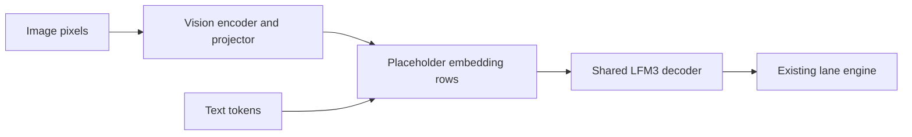

# LFM3 native Metal bring-up

Tracking issue: [#1491](https://github.com/ashhart/TensorFold/issues/1491).

This slice implements native LFM3-1.7B text generation. LFM3-VL execution is in the dependent vision slice.
Both read the official MLX affine 4-, 6-, and 8-bit checkpoints without converting stored weights.
This is an experimental family port. Device and model checks cover an M4 Pro and an M5 Ultra; they do not qualify other Apple GPUs.

## Run the models

Build the native engine with the Zig version in `.zig-version` and Xcode's Metal toolchain:

```sh
zig build native -Dcpu=apple_m1
./zig-out/native/bin/tensorfold-native serve LiquidAI/LFM3-1.7B-MLX-4bit --context 8192
```

Replace `4bit` with `6bit` or `8bit` for those exports. A complete local checkpoint folder also works.
This slice refuses VL checkpoints until the vision contribution is applied.
Image budgets and decoder libraries are described by the stacked VL contribution.

The shared lane engine handles target verification, sampling and concurrent streams.
Convolution history and KV state are kept per stream; partial acceptance restores the accepted row's state.
Raw prompts of at least 256 tokens can build a repeat-cache entry: the first request records interest,
the second keeps a prefix state, and a later repeat resumes it. Image cache identity includes image content and grid.



## Inspect a checkpoint

Use Python 3.11 or newer. The inspector uses the standard library. It resolves a full Hugging Face commit,
reads the config and index, and requests only the safetensors headers. It refuses a server that returns a
complete weight file instead of the requested byte range.

```sh
python3 tools/lfm3/inspect_checkpoint.py LiquidAI/LFM3-1.7B-MLX-4bit --output text4.json
python3 tools/lfm3/inspect_checkpoint.py LiquidAI/LFM3-VL-2B-MLX-4bit --output vl4.json
```

Replace `4bit` with `6bit` or `8bit` to inspect those exports. Pass `--revision COMMIT` to repeat a pinned inspection.
Use `--local-dir MODEL_DIR` instead of a repository name to inspect files already on disk.

## Check the native text layout

Use the Zig version in `.zig-version`.

```sh
zig build test-lfm3-host tf-lfm3-check
./zig-out/bin/tf-lfm3-check text4.json
./zig-out/bin/tf-lfm3-check vl4.json
python3 -m unittest discover -s tools/lfm3 -p 'test_*.py' -v
```

The native checker reads the saved metadata, validates shard header geometry, and checks the LFM3 text decoder's
required names, dtypes, shapes, and byte counts. It performs no projection, GPU allocation, or model inference.
For VL, it checks the text decoder only. A passing result does not validate vision weights or image processing.

The config reader preserves full-attention versus sliding-attention layers, distinct rotary settings, sandwich norms,
and each module's affine width and group size. Unsupported geometry and conflicting quantization declarations fail.

## Checkpoint details

All six inspected MLX exports store the decoder under `language_model.model.*`, including the text-only model.
Each decoder has 594 tensors. Convolution kernels are BF16 with shape `[2048, 7, 1]`.

Text 4/6/8-bit and VL 6/8-bit use affine groups of 64. VL 4-bit uses groups of 32 and an 8-bit embedding override.
The 138 additional VL vision/projector tensors are BF16 in all three exports. Global quantization metadata must not
cause these dense tensors to be treated as packed affine weights.

The header inspections used these revisions:

- Text 4-bit: `d0ca73dcfa70ce18733754a492cdc1fb0123262d`.
- Text 6-bit: `26be898c36b545d625d84ac0761c6c3eb664aef3`.
- Text 8-bit: `ee7667f3cfccb2a41725f91820531823fcabc6b7`.
- VL 4-bit: `c823fade98e35a3d6942ad4d38b1ea15f675cd12`.
- VL 6-bit: `6d71bfae121abedc75f6d531fc7f6ceb4f5e3501`.
- VL 8-bit: `83336d5be3874a2bdd3297bde77b2114dbd3a816`.

## Qualification and remaining gate

Detailed counts, hashes, numerical evidence and reproducible requests are in the [receipts](../receipts/lfm3/README.md).

All six checkpoints passed 303 greedy/seeded-sampling, cache, concurrency and cancellation checks on one optimized M4 binary.
The final source build also passed 303/303 on an M5. Text4 and VL4 additionally passed real grammar, thinking, tool,
streaming, history and image-conditioned tool checks with the matching optional grammar library.
The 4-bit text long exactness suite passed all 73 cases through 8,193-token seams.
The final family contract passed 50 kernels and caught all 13 real controls, with zero limit problems.

Independent projection audits covered 66 class/layout cells and 60,954,624 outputs with no violations of existing FP32/BF16 bounds.
The row-pair optimization preserves the shared arithmetic: 132 checkpoint calls and a full 8,193-token logit comparison were byte-identical.
On the M5, controlled 4-bit cold requests improved text engine prefill from 1.240 to 0.813 seconds at 2k and
73.402 to 61.633 seconds at 64k; VL decoder requests improved from 1.262 to 0.815 and 73.920 to 59.647 seconds.
These are engine prefill measurements; the receipt also retains client TTFT. All compared full output-token hashes matched.

Native inference retains the checkpoint's BF16 activation boundaries and FP32 reductions.
Text trigonometric values round to BF16 before rotation; vision axial trigonometric values remain FP32.
The CPU FP64 oracle records numerical differences rather than inventing a tie policy.
MLX's vector/matrix quantized paths use different effective reconstruction, and bounded FP32 differences can propagate through history.
See the exact primitive and whole-model evidence before interpreting a next-token mismatch.

```sh
zig build tf-lfm3-forward tf-lfm3-vision tf-lfm3-project tf-lfm3-profile tf-lfm3-exact -Dcpu=apple_m1
./zig-out/bin/tf-lfm3-exact MODEL_DIR --long
python3 tools/lfm3/serve_check.py --binary ./zig-out/native/bin/tensorfold-native --model-dir MODEL_DIR --sampled --cancel --output served.json
```

Long-context model fidelity, maximum image budgets, 6/8-bit performance and other Apple GPU generations remain separate qualification work.
Structured output requires the native grammar library; logprobs and video are not advertised.
A complete earlier global M5 contract run found one Qwen4 failure that also reproduces on the unchanged pinned base.
It is not a final-source global pass. Agree model-fidelity and performance gates on #1491 before claiming release readiness.

## Weight licence

The official text and VL MLX exports retain the LFM Open License v1.0.
See the [text licence](https://huggingface.co/LiquidAI/LFM3-1.7B-MLX-4bit/blob/main/LICENSE) and
[VL licence](https://huggingface.co/LiquidAI/LFM3-VL-2B-MLX-4bit/blob/main/LICENSE).
TensorFold code remains Apache-2.0. The measured Macs are M4 Pro 48 GB and M5 Ultra 256 GiB.
Receipts that include VL describe the combined chain, not a capability enabled in this text-only slice.
