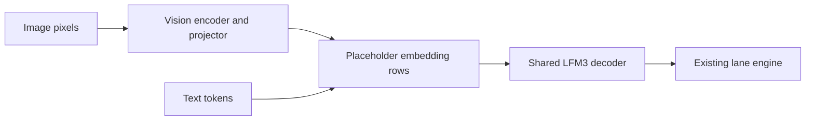

# LFM3 native Metal bring-up

Tracking issue: [#1491](https://github.com/ashhart/TensorFold/issues/1491).

This slice implements native LFM3-1.7B text generation. LFM3-VL execution is in the dependent vision slice.
Both read the official MLX affine 4-, 6-, and 8-bit checkpoints without converting stored weights.
This is an experimental family port. Device and model checks cover an M4 Pro and an M5 Ultra; they do not qualify other Apple GPUs.

## Run the models

Build the native engine with the Zig version in `.zig-version` and Xcode's Metal toolchain:

```sh
zig build native -Dcpu=apple_m1
./zig-out/native/bin/tensorfold-native serve LiquidAI/LFM3-1.7B-MLX-4bit --context 8192
```

Replace `4bit` with `6bit` or `8bit` for those exports. A complete local checkpoint folder also works.
This slice refuses VL checkpoints until the vision contribution is applied.
Image budgets and decoder libraries are described by the stacked VL contribution.

The shared lane engine handles target verification, sampling and concurrent streams.
Convolution history and KV state are kept per stream; partial acceptance restores the accepted row's state.
Raw prompts of at least 256 tokens can build a repeat-cache entry: the first request records interest,
the second keeps a prefix state, and a later repeat resumes it. Image cache identity includes image content and grid.



## Inspect a checkpoint

Use Python 3.11 or newer. The inspector uses the standard library. It resolves a full Hugging Face commit,
reads the config and index, and requests only the safetensors headers. It refuses a server that returns a
complete weight file instead of the requested byte range.

```sh
python3 tools/lfm3/inspect_checkpoint.py LiquidAI/LFM3-1.7B-MLX-4bit --output text4.json
python3 tools/lfm3/inspect_checkpoint.py LiquidAI/LFM3-VL-2B-MLX-4bit --output vl4.json
```

Replace `4bit` with `6bit` or `8bit` to inspect those exports. Pass `--revision COMMIT` to repeat a pinned inspection.
Use `--local-dir MODEL_DIR` instead of a repository name to inspect files already on disk.

## Check the native text layout

Use the Zig version in `.zig-version`.

```sh
zig build test-lfm3-host tf-lfm3-check
./zig-out/bin/tf-lfm3-check text4.json
./zig-out/bin/tf-lfm3-check vl4.json
python3 -m unittest discover -s tools/lfm3 -p 'test_*.py' -v
```

The native checker reads the saved metadata, validates shard header geometry, and checks the LFM3 text decoder's
required names, dtypes, shapes, and byte counts. It performs no projection, GPU allocation, or model inference.
For VL, it checks the text decoder only. A passing result does not validate vision weights or image processing.

The config reader preserves full-attention versus sliding-attention layers, distinct rotary settings, sandwich norms,
and each module's affine width and group size. Unsupported geometry and conflicting quantization declarations fail.

## Checkpoint details

All six inspected MLX exports store the decoder under `language_model.model.*`, including the text-only model.
Each decoder has 594 tensors. Convolution kernels are BF16 with shape `[2048, 7, 1]`.

Text 4/6/8-bit and VL 6/8-bit use affine groups of 64. VL 4-bit uses groups of 32 and an 8-bit embedding override.
The 138 additional VL vision/projector tensors are BF16 in all three exports. Global quantization metadata must not
cause these dense tensors to be treated as packed affine weights.

The header inspections used these revisions:

- Text 4-bit: `d0ca73dcfa70ce18733754a492cdc1fb0123262d`.
- Text 6-bit: `26be898c36b545d625d84ac0761c6c3eb664aef3`.
- Text 8-bit: `ee7667f3cfccb2a41725f91820531823fcabc6b7`.
- VL 4-bit: `c823fade98e35a3d6942ad4d38b1ea15f675cd12`.
- VL 6-bit: `6d71bfae121abedc75f6d531fc7f6ceb4f5e3501`.
- VL 8-bit: `83336d5be3874a2bdd3297bde77b2114dbd3a816`.

## Qualification and remaining gate

Detailed counts, hashes, numerical evidence and reproducible requests are in the [receipts](../receipts/lfm3/README.md).

All six checkpoints passed 303 greedy/seeded-sampling, cache, concurrency and cancellation checks on one optimized M4 binary.
The final source build also passed 303/303 on an M5. Text4 and VL4 additionally passed real grammar, thinking, tool,
streaming, history and image-conditioned tool checks with the matching optional grammar library.
The 4-bit text long exactness suite passed all 73 cases through 8,193-token seams.
The final family contract passed 50 kernels and caught all 13 real controls, with zero limit problems.

Independent projection audits covered 66 class/layout cells and 60,954,624 outputs with no violations of existing FP32/BF16 bounds.
The row-pair optimization preserves the shared arithmetic: 132 checkpoint calls and a full 8,193-token logit comparison were byte-identical.
On the M5, controlled 4-bit cold requests improved text engine prefill from 1.240 to 0.813 seconds at 2k and
73.402 to 61.633 seconds at 64k; VL decoder requests improved from 1.262 to 0.815 and 73.920 to 59.647 seconds.
These are engine prefill measurements; the receipt also retains client TTFT. All compared full output-token hashes matched.

Native inference retains the checkpoint's BF16 activation boundaries and FP32 reductions.
Text trigonometric values round to BF16 before rotation; vision axial trigonometric values remain FP32.
The CPU FP64 oracle records numerical differences rather than inventing a tie policy.
MLX's vector/matrix quantized paths use different effective reconstruction, and bounded FP32 differences can propagate through history.
See the exact primitive and whole-model evidence before interpreting a next-token mismatch.

```sh
zig build tf-lfm3-forward tf-lfm3-vision tf-lfm3-project tf-lfm3-profile tf-lfm3-exact -Dcpu=apple_m1
./zig-out/bin/tf-lfm3-exact MODEL_DIR --long
python3 tools/lfm3/serve_check.py --binary ./zig-out/native/bin/tensorfold-native --model-dir MODEL_DIR --sampled --cancel --output served.json
```

Long-context model fidelity, maximum image budgets, 6/8-bit performance and other Apple GPU generations remain separate qualification work.
Structured output requires the native grammar library; logprobs and video are not advertised.
A complete earlier global M5 contract run found one Qwen4 failure that also reproduces on the unchanged pinned base.
It is not a final-source global pass. Apply the agreed policy below before claiming release readiness.

### Qualification policy

The [maintainer decision](https://github.com/ashhart/TensorFold/issues/1491#issuecomment-6537143418)
sets the policy; it does not turn every existing receipt into a pass:

- **Model fidelity:** native must be no further from an independent FP32 run than the reference's own BF16 result.
  Retain every top-token difference and both margins. Partial remains partial; pooled RMS, same-engine exactness
  and kernel-contract results do not substitute for model-fidelity adjudication.
- **Performance exception:** the documented default-route cold-prefill deficit does not block the opt-in text slice.
  This is a scoped exception, not a measured performance pass or a waiver for other routes.
- **Context tier:** 32k remains the release tier pending long-context reference-fidelity adjudication.
  Longer runtime/memory observations alone do not raise that tier or establish model fidelity.
- **Separate evidence cells:** retain backend, GPU/RAM, candidate and checkpoint revisions, context, arithmetic/build
  flags, scheduler settings and prompt identity. Inspection revisions above are not automatically measurement pins.
  Do not transfer M5 NAX/tiled results to default builds, M4, CUDA or another checkpoint.
- **Missing provenance and memory:** write unknown when a receipt does not record a field; an artifact's repository
  commit is not the measured binary's commit. Keep physical footprint and device allocations separate; absent
  device counters are not zero. An interrupted peak does not bound a completed run or qualify a smaller host.

### Evidence ledger

This table is the source for the receipts README matrix. Each outcome is scoped to its linked evidence, not a
family-wide verdict. Pinned links locate artifacts, not necessarily measured commits. The pending #1502 rows
are historical opt-in evidence and do not advertise that route as landed in this text-only slice.
The existing reproduction commands above and in the receipts README remain the way to repeat the corresponding
checks; comment-backed maintainer checks are not silently promoted into fully specified benchmark protocols.

<!-- lfm3-evidence:start -->
| Cell / evidence | Route / provenance | Observation | Qualification / limitation |
|---|---|---|---|
| Extracted text4/6/8 correctness, [receipt](https://github.com/ashhart/TensorFold/blob/32505ce8dcbb1de73e3b22fc5849bbd74c8916d8/docs/receipts/lfm3/final-extracted-text.json) | Metal; M4 Pro, 48 GiB, macOS 26.5.1; measured source `73bc567c039b7471ad621fa249b69801f1d86de5`; per-width checkpoint revisions and binary/file hashes in receipt | 120 served checks, 18 cancellation checks; 15 selected focused-state checks; 49,920,000 logit-bridge bytes equal combined build | Historical extracted-text correctness, not a new independent-reference fidelity verdict. Receipt explicitly has no performance measurements and no long-context transfer claim. |
| Text4 runtime, [M5 maintainer check](https://github.com/ashhart/TensorFold/pull/1514#issuecomment-6658620362) | Metal; M5 Ultra; candidate `a19bb684569957de339548a4395d18491942e97c`; checkpoint revision/RAM/full invocation not recorded in comment | Two runs; 0/20 prompt rows differ; 12/12 concurrent replies equal solo; solo equals draft-disabled; thinking on/off | Scoped runtime/exactness, not independent-reference fidelity or all-width acceptance. The absent main arm at measurement time was not a candidate failure. |
| Text4 runtime, [M3 maintainer check](https://github.com/ashhart/TensorFold/pull/1514#issuecomment-6673067861) | Metal; M3 Ultra; historical text candidate `a19bb6845`; checkpoint revision/RAM/full invocation not recorded in comment | 160/160 exact comparisons; 120 replies finished; 2k/8k prefill 2043/1508 tok/s, decode 133.5/138.6 tok/s | This host's runtime observation, not every Apple chip/width or a new FP32/BF16 verdict. |
| Default text/reference performance, [receipt](https://github.com/ashhart/TensorFold/blob/32505ce8dcbb1de73e3b22fc5849bbd74c8916d8/docs/receipts/lfm3/m5-text-slice-vs-mlx.json) | Metal; M5 Ultra; no NAX/tiled/split/stepped route; text4; cache off, greedy max 128, context 70000, four configured lanes, three timed runs after warm-up | At 2k/8k: client TTFT native 0.85/4.61 s vs reference 0.095/0.350 s; contextual decode native 169/165 vs reference 334/317 tok/s (rounded) | Default route remains slower. Measured source/checkpoint revisions and full environment are not recorded in this artifact; do not substitute its repository pin. Preserve the scoped performance exception. |
| Pending #1502 optimized performance, [cold receipt](https://github.com/BlivionIaG/TensorFold/blob/e7d733602ce0f984acc4feb67b803a946fed5eb8/docs/receipts/lfm3/m5-nax-cold-prefill-vs-mlx.json), [serving receipt](https://github.com/BlivionIaG/TensorFold/blob/e7d733602ce0f984acc4feb67b803a946fed5eb8/docs/receipts/lfm3/m5-nax-serving-metrics.json) | Metal; M5 Ultra; six checkpoints; `-Dlfm3-nax-prompt=true -Dlfm3-tiled-attention=true`; cache off; exact measurement/checkpoint revisions and full environment not recorded | Reported 2k–64k native/reference cold TTFT 0.86–1.05x; single-stream decode 1.10–1.28x | Pending opt-in route, not default-build, M4 or release qualification. Cold TTFT and decode have different measurement definitions. |
| Pending #1502 text4 scheduling, [receipt](https://github.com/BlivionIaG/TensorFold/blob/e7d733602ce0f984acc4feb67b803a946fed5eb8/docs/receipts/lfm3/m5-nax-decode-share.json) | Same pending NAX/tiled M5 route; four streams, 8k, greedy max 128, cache off; `--decode-share 0.75` | p95 streamed-chunk gap about 2.6 ms, with lower prompt throughput than default scheduling | Scheduling-specific tradeoff, not a single aggregate faster verdict; streamed-chunk gaps need not be per-token ITL. |
| Pending #1502 text4 default scheduling, [serving receipt](https://github.com/BlivionIaG/TensorFold/blob/e7d733602ce0f984acc4feb67b803a946fed5eb8/docs/receipts/lfm3/m5-nax-serving-metrics.json) | Same pending NAX/tiled M5 route; four streams, 8k; default scheduling, not the landed default arithmetic route | p95 streamed-chunk gap about 45.8 ms vs reference 5.2 ms | Keep separate from decode-share. Aggregate decode starts after the last first-token event; compare compatible definitions and completion lengths. |
| Pending #1502 32k fidelity, [receipt](https://github.com/BlivionIaG/TensorFold/blob/e7d733602ce0f984acc4feb67b803a946fed5eb8/docs/receipts/lfm3/m5-nax-32k-fidelity.json) | Metal; M5 Ultra; NAX/tiled route; six checkpoints, fixed token histories, independent FP32 and official MLX BF16; measurement/checkpoint revisions not recorded | 102 rows; pooled native/reference error ratio 0.9574768752; six rows above 1.5x; native-only VL6 continuation mismatch with FP32 margin 0.134; some per-phase `proposed_metrics_not_met` | Not a blanket pass: retain row-level differences/margins and seek adjudication under the agreed bar. Proposed diagnostic metrics are not an automatically agreed acceptance algorithm. |
| CUDA evidence lanes, [#1508](https://github.com/ashhart/TensorFold/pull/1508), [#1634](https://github.com/ashhart/TensorFold/pull/1634) | Separate owner-maintained backend/hardware/stored-format cells | Not consolidated into this Metal ledger | No CUDA verdict inferred from Metal or unrelated-family GB10 regression checks. These links are coordination pointers, not a claim that the owners lack receipts. |
<!-- lfm3-evidence:end -->

Regenerate the README matrix after editing this table, then check for stale output:

```sh
python3 tools/lfm3/render_evidence.py
python3 tools/lfm3/render_evidence.py --check
python3 -m unittest discover -s tools/lfm3 -p 'test_render_evidence.py' -v
```

The renderer checks marker/table structure and copies the block verbatim; it does not adjudicate scientific
acceptance, supply missing provenance or rewrite relative links. Keep table links portable to both documents.

## Weight licence

The official text and VL MLX exports retain the LFM Open License v1.0.
See the [text licence](https://huggingface.co/LiquidAI/LFM3-1.7B-MLX-4bit/blob/main/LICENSE) and
[VL licence](https://huggingface.co/LiquidAI/LFM3-VL-2B-MLX-4bit/blob/main/LICENSE).
TensorFold code remains Apache-2.0. The measured Macs are M4 Pro 48 GB and M5 Ultra 256 GiB.
Receipts that include VL describe the combined chain, not a capability enabled in this text-only slice.
